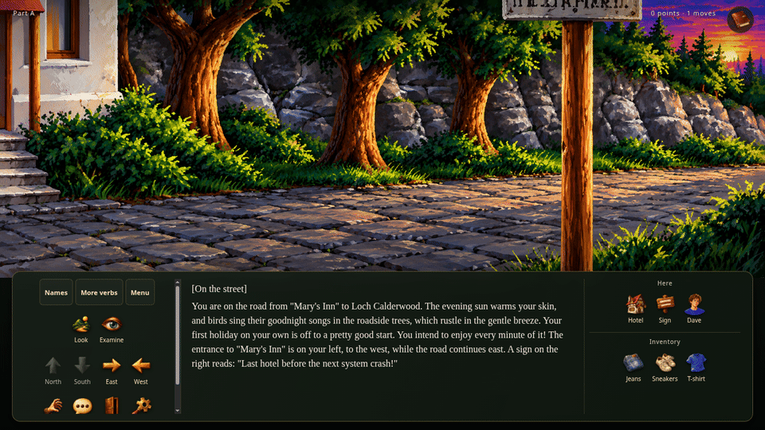

# Soul Crystal

## [▶ Play Soul Crystal in your browser](https://s-macke.github.io/Soul_Crystal/)

**German & English · No installation required**

[](https://s-macke.github.io/Soul_Crystal/)

[*Soul Crystal*](https://www.c64-wiki.de/wiki/Soul_Crystal) is a German-language
text adventure that I played in the 1990s.
At the time, I was still learning English at school, and my English was not yet
good enough to comfortably play adventures in that language. Being able to play
in German made a real difference. I remember *Soul Crystal* as one of the best
German-language text adventures I had the chance to play back then, and it
stayed with me long after those first playthroughs.

Many years later, the C64 version also became accessible to English-speaking
players: [Onslaught released an English fan translation in 2023](https://www.lemon64.com/game/soul-crystal).
That translation forms the basis of the English text included in this project.

I started reverse-engineering *Soul Crystal* in 2006, twenty years ago, out of
curiosity. I began with the C64 version and worked my way into its code: first
to extract the texts, then the images, and eventually the gameplay logic.

One question kept me going: how do you activate the C64 cheat mode? I had found
the cheat-related texts in the game data, but could never find a way to enable
it. The answer, as it turns out, is that the cheat mode does not exist in the
C64 version. The texts are there; the functionality is not.

The DOS and Amiga versions added another mystery. Knowledge of how to activate
their cheats seemed to have been lost along the way. Revisiting the original
code brought some of those answers back to light; the recovered DOS mechanism
is documented in the [cheat mode notes](spec/DOS/cheat_mode.md).

For twenty years, I returned to the project now and then, taking another step
whenever time and curiosity brought me back. With AI helping, the remaining
work finally came together in two weeks—and went much further than I had
originally imagined: a playable browser adaptation with reimagined graphics
and a new interface, and even voiced interludes between parts of the adventure.

What began as a personal investigation has become a way to experience the game
again. This repository brings that adaptation together with a standalone
console version, extracted assets, and documentation of the original game.

## Textkonsole

```sh
./build_console.sh
./build/soul-crystal --language de
./build/soul-crystal --language en
```

Deutsch (Standard) und die englische C64-Fanübersetzung verwenden dieselbe
Spiellogik. Spielbare Basis mit einkompilierten Texten, Intro, Verbliste und
zustandsabhängiger Objektliste. Keine Laufzeitdateien oder zusätzlichen Libraries.
Handbuchabfragen sind deaktiviert; die Teilübergänge laufen ohne Rückfrage weiter;
Speichern/Laden und Cheats sind nicht enthalten.
Details und Tests: [Konsolenanwendung](spec/C64/console_application.md).

Die vorhandene Komplettlösung dient als Grundlage für einen automatischen
[Replay-Runner](tests/replays/README.md):

```sh
./build/soul-replay tests/replays/part_a.replay
```

Die vollständige Hauptroute erreicht mit 597 Befehlen und 410 Prüfstellen den
Gewinn (5.010 Punkte). Zusätzlich gibt es `tests/replays/fast.replay` mit der
ursprünglichen 334-Befehle-Route sowie 46 eigenständige Todesfall-Replays.
`./check-replay.sh` prüft alle Läufe; `./check-replay-coverage.sh` misst ihre
kombinierte Skriptabdeckung. `./check-replay-texts.sh` listet tatsächlich
ausgegebene und noch fehlende Originaltexte. Ergebnisse und Grenzen:
[Abdeckungsbericht](spec/C64/replay_coverage.md).

## Webport (TypeScript, Vite und WebAssembly)

```sh
./build_wasm_docker.sh
npm ci --prefix web
npm run dev --prefix web
```

Spielbarer Browserport mit Amiga-HD-Bildern, deutscher/englischer Sprachwahl und
Symbolsteuerung. Der vorhandene C/C++-Kern wird im Dockerfile zu WebAssembly gebaut.
Mit lokalen Browser-Spielständen und Autosaves; ohne Musik. Details: [Webport](web/README.md).

## Frühere SPECIAL-Notizen


      3 SPECIAL(0x0001);    coderequest? passwortabfrage?
      4 SPECIAL(0x0002);    laden
      4 SPECIAL(0x0003);    speichern
      4 SPECIAL(0x0004);    neustart 
      4 SPECIAL(0x0005);    spielende
      4 SPECIAL(0x0006);    Loesung
      4 SPECIAL(0x0007);    Musik ein
      8 SPECIAL(0x0008);    Ausgaenge anzeigen
      4 SPECIAL(0x0009);    Diskette installieren
      4 SPECIAL(0x000a);    Inventar anzeigen
      1 SPECIAL(0x0032);    Der Code ist Ok Text
      1 SPECIAL(0x0033);    gewonnen: zeige das ende des spiels: danach hall of fame und dann credits
      4 SPECIAL(0x0064);    
      4 SPECIAL(0x0065);
      4 SPECIAL(0x0066);    // compares command variable
      4 SPECIAL(0x0067);
      1 SPECIAL(0x0068);    // compares room numbers
      1 SPECIAL(0x0069);
      1 SPECIAL(0x006a);
      1 SPECIAL(0x00c8);  // test: exgosub - 200

